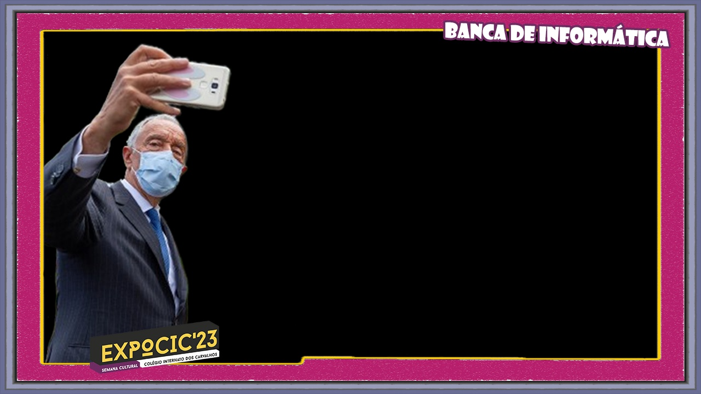

# Olha o passarinho! 📸

A webcam photo booth built with Python and OpenCV for **ExpoCIC 2023**, with a PHP/MySQL web gallery where visitors can find and download their photos.



## About

*"Olha o passarinho!"* is the Portuguese equivalent of "Say cheese!". This project was built by two 12th grade students for the IT stand at **ExpoCIC 2023**, the cultural week of Colégio Interno dos Carvalhos (Portugal), in March 2023.

Visitors stood in front of a webcam and took a photo with the event's frame. They could also appear next to a famous character, chosen by holding an object of a given **colour** in the top-left corner of the camera. Every photo was uploaded to a server and published on a website, organised by class or group.

The project was recovered in 2026 so it can run again, locally with Docker or on a web server.

## Features

- Live webcam preview with the ExpoCIC frame
- 15 characters, picked by the colour detected in the top-left corner (HSV hue)
- Each photo saved in up to 3 versions: original, with frame, and with frame and character
- Automatic upload to a PHP server, with each photo recorded in a MySQL database
- Web gallery with category filter, "show more" pagination and download button
- HSV calibration tool to tune the colour ranges

## How it works

```
┌──────────────────────┐   upload.php    ┌──────────────────┐
│  Python script       │ ──────────────► │  PHP server      │
│  (webcam + OpenCV)   │   upload_bd.php │  + MySQL         │
└──────────────────────┘ ──────────────► └────────┬─────────┘
                                                  │ index.php
                                                  ▼
                                         Photo gallery (website)
```

1. **`python/olha_o_passarinho.py`** reads the hue of the top-left pixel to choose a character. Pressing **Space** asks for the category (class, visitors, teachers…) and creates the photos.
2. **`web/upload.php`** receives the images and **`web/upload_bd.php`** stores them in the database.
3. **`web/index.php`** shows the gallery.

## Tech stack

- **Photo booth:** Python, OpenCV, Requests
- **Web:** PHP 8, HTML/CSS (W3.CSS), JavaScript
- **Database:** MariaDB / MySQL
- **Development environment:** Docker Compose (PHP + Apache, MariaDB, Adminer)

## Getting started

### Prerequisites

- [Docker Desktop](https://www.docker.com/products/docker-desktop/)
- Python 3.10+
- A webcam

### Installation

Clone the repository and start the web server and database:

```bash
git clone https://github.com/derqleine/olha-o-passarinho.git
cd olha-o-passarinho
docker compose up -d
```

| Service | URL |
|---|---|
| Gallery | http://localhost:8000 |
| Adminer (database admin) | http://localhost:8080 (server `db`, user `olha`, password `olha`) |

The database is created automatically from `database/polaroidexpocic.sql` on the first run. To change the passwords, copy `.env.example` to `.env`.

Then set up the photo booth:

```bash
cd python
python -m venv .venv
.venv\Scripts\activate        # Linux/macOS: source .venv/bin/activate
pip install -r requirements.txt
```

### Usage

```bash
python olha_o_passarinho.py
```

1. Answer whether you want a photo with a character (`S`/`N`).
2. Hold a coloured object in the top-left corner of the camera to pick a character.
3. Press **Space** to take the photo and choose a category.
4. Press **Esc** to quit.

The photos appear in the gallery at http://localhost:8000.

To stop the containers, run `docker compose down`. Add `-v` to also delete the database.

## Deploying to a server

- **Web:** upload the `web/` folder to a PHP host, import `database/polaroidexpocic.sql` and create `web/config.php` from `web/config.example.php` with your database credentials (`config.php` is git-ignored).
- **Photo booth:** point the script to your server with the `OLHA_SERVER_URL` environment variable:

  ```bash
  set OLHA_SERVER_URL=https://example.com/olha-o-passarinho
  python olha_o_passarinho.py
  ```

<details>
<summary>Running locally without Docker (XAMPP or PHP + MySQL)</summary>

Import `database/polaroidexpocic.sql` into MySQL/MariaDB (user `root` with no password by default) and start the web server with `php -S localhost:8000 -t web`. The `mysqli` extension is required.

</details>

## Project structure

```
olha-o-passarinho/
├── python/            # Photo booth script, HSV colour picker, frame and character images
├── web/               # Gallery website and upload endpoints (PHP)
├── database/          # Database schema
├── docker/            # Dockerfile for the PHP server
├── design/            # Working material: colour table, original and cut-out characters, Photoshop files
├── docs/              # Original project description (Portuguese) and README images
└── compose.yaml       # Docker Compose setup
```

## Known issues

- The app's interface is only in Portuguese.

## Authors

- **Afonso Saraiva**
- **Gabriel Sousa** ([@derqleine](https://github.com/derqleine))

## Acknowledgements

- Colégio Interno dos Carvalhos and the ExpoCIC 2023 organisation.
- The character images belong to their respective owners and were used in a non-commercial school context.

## License

The source code is licensed under the [MIT License](LICENSE).

The character images, the ExpoCIC and school logos are **not** covered by this license and belong to their respective owners.
